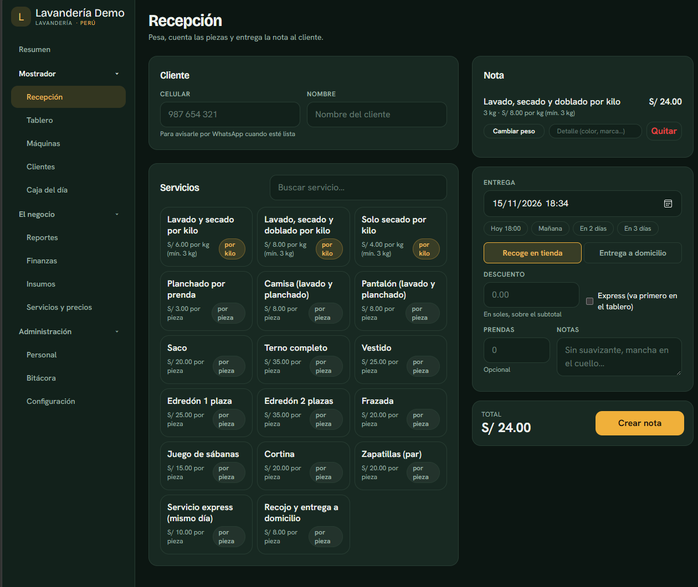

# Observaciones y mejoras del SaaS

## Ejemplo técnico

### EJEMPLO-T — Consultas repetidas y gestión de datos

- **Tipo:** Técnica.
- **Clase:** Duda y propuesta de librería.
- **Dónde:** Frontend; al entrar a Clientes, Servicios u Órdenes.
- **Qué observo:** En desarrollo aparecen dos solicitudes iguales en la pestaña Network del navegador.
- **Qué espero o necesito:** Entender por qué sucede y evitar solicitudes innecesarias manteniendo datos actualizados.
- **Pregunta / propuesta:** ¿Conviene incorporar TanStack Query para compartir consultas en curso y manejar caché, carga y errores? ¿Qué cambiaría respecto al hook actual?
- **Cómo comprobarlo:** Abrir las herramientas del navegador → Network → Fetch/XHR → entrar a Servicios.
- **Impacto:** Dudas sobre consumo de recursos y mantenimiento del frontend.
- **Captura o referencia:** Adjuntar si hace falta.
- **Importancia para mí:** Por definir.

## Ejemplo funcional / no técnico

### EJEMPLO-F — Registrar un cliente al recibir su pedido

- **Tipo:** Funcional / uso diario.
- **Clase:** Mejora del flujo de trabajo.
- **Dónde:** Órdenes → Recibir pedido.
- **Qué observo:** Si llega un cliente nuevo, tengo que ir a Clientes para registrarlo y después volver a crear su pedido.
- **Qué espero o necesito:** Poder registrar al cliente desde la pantalla del pedido sin perder los servicios o pesos que ya ingresé.
- **Pregunta / propuesta:** Agregar una opción «Nuevo cliente» junto al selector y dejarlo seleccionado después de guardarlo.
- **Cómo comprobarlo:** Comenzar una orden e intentar seleccionar a un cliente que todavía no existe.
- **Impacto:** Hace más lenta la atención cuando hay personas esperando en el mostrador.
- **Captura o referencia:** Opcional.
- **Importancia para mí:** Alta si recibimos clientes nuevos con frecuencia.

---

## Mis observaciones

### OBS-001 — Bloqueo al ingresar digito al registrar pieza o kilos

- **Tipo:** Técnica
- **Clase:** Error
- **Dónde:** Pantalla
- **Qué observo:** Cuando quiero ingresar algun valor de prenda como kilos o piezas, me indica que tiene que ser un valor erroneo, deberia de ser 1 pieza, y se tiene que colocar 1.001, segun el validador del input
- **Qué espero o necesito:** Si son piezas como camisa o toalla, deben ser enteros, si son kilos, maximo deberian ser 2 decimales como: 2.45, se incluso pueda haber una opcion en las configuraciones para que se redondee segun necesidad o no del cliente, como un boton en configuraciones para que se redondee o no.
- **Impacto:** Te bloquea por completo al cliente
- **Importancia para mí:** Alta

### OBS-002 — Add paquetes al stack

- **Tipo:** Técnica
- **Clase:** Propuesta
- **Dónde:** Front
- **Qué espero o necesito:** Agregar paquetes del ecosistema de react, como: react hook form, react router, Zustand, tanstack table, react query. Para validar con ayuda de zod los formularios, router para ver el cambio de url al navegar entre modulos o regresar a la pagina anterior, manejo correcto del estado, manejar correctamente las tablas donde se necesite, el manejo de los datos tambien, hacer llamadas cuando se se cambia de tab o se minimice la web app
- **Impacto:** Correcto funcionamiento y mejor orden para la experiencia del cliente
- **Importancia para mí:** Alta

### OBS-003 — Mejora ux/ui al registrar pedidos

- **Tipo:** Funcional
- **Clase:** Propuesta
- **Dónde:** Pantalla de nueva orden
- **Qué espero o necesito:** Ingresar el celular del cliente, y mientras se escribe de existir algun pedido previo con el, muestre su celular y nombre para autocompletar tanto el nombre y celular, esto puede aplicarse tambien, si escribimos su nombre y aparezca el posible numero para da click, con debounce, para no hacer llamadas innecesarias al escribir. Ademas en esta pantalla se deberia mostrar los servicios, clasificados por kilos o piezas para que el administrador/empleado le dea click al servicio deseado, y la clasificacion, en grupos o labels para diferenciarlos. y al hacer click sobre cada card de servicio, se habar un cuadro emergente y si fue elegido algo de kilos como 'lavado y secado por kilo' en ese cuadro se muestre un input que admita decimales, y tambien algunos posibles valores, como 1,2,3,4,5. y al darle al boton de agregar se vea como en las aplicaciones de delivery, que el contador de servicios/precio aumenta, para darle retroalimentacion al usuario que se agrego el servicio. adicionalmente agregar notas en cada servicio que se agrega en el "subtotal". agregar tambien cuando recoger, como al dia siguiente, el mismo dia, o en 2 dias (como botones con valores posibles), un input de descuento si desea, un checkbox para express y se coloque lo mas arriba del tablero principal de ordenes, numero de prendas y una nota principal de la orden. y un boton de crear orden.
- **Impacto:** mejora rapidez de crear orden
- **Importancia para mí:** Alta
- **Imagen de guia:** 
